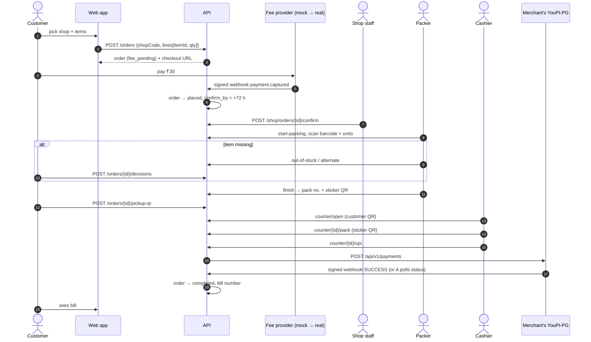
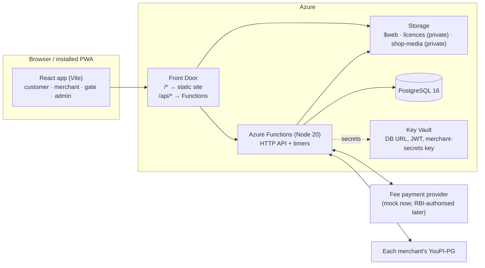
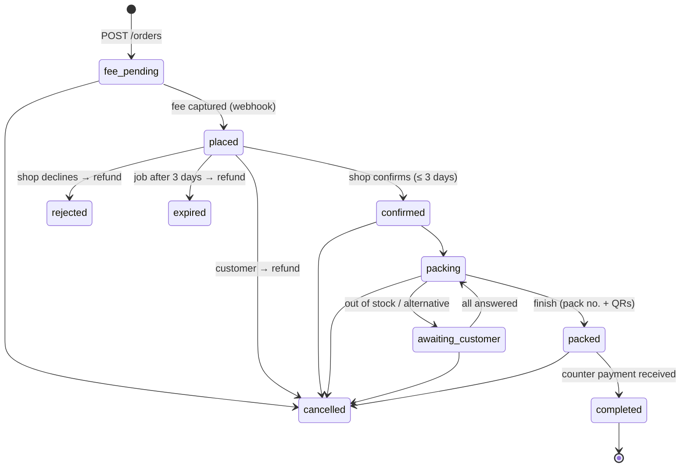

# Diwali Express Pickup — Platform Overview

The one document to read first. It explains what the platform does, how it is built, how to run
and test it, how the money moves, which rules it enforces, and how to extend it safely.

| If you need…                              | Read                                                                                   |
| ----------------------------------------- | -------------------------------------------------------------------------------------- |
| The product and architecture in one place | this file                                                                              |
| The binding product spec                  | [docs/SPEC_V3_ORDERS.md](docs/SPEC_V3_ORDERS.md) (amends [docs/SPEC.md](docs/SPEC.md)) |
| Rules for anyone (or any AI agent) coding | [CLAUDE.md](CLAUDE.md)                                                                 |
| Running it in five minutes                | [README.md](README.md)                                                                 |
| Deploying to Azure                        | [docs/DEPLOY.md](docs/DEPLOY.md)                                                       |
| Legal / payment research behind decisions | [docs/MARKETPLACE_PHASE0_AUDIT.md](docs/MARKETPLACE_PHASE0_AUDIT.md)                   |
| What changed and when                     | [CHANGELOG.md](CHANGELOG.md)                                                           |

---

## 1. What the platform is

**Diwali Express Pickup** is a pickup-order platform for **many licensed Diwali merchants** in
Hyderabad, onboarded by the platform team.

1. A customer picks a locality, a licensed shop and products (photos, prices, offers).
2. They place an order and pay a **₹30 platform fee** online.
3. The merchant **confirms within 3 days** — or the ₹30 is **refunded automatically**.
4. A **packer** scans every item's barcode. Missing items are marked **out of stock** or an
   **alternative** is offered; the customer must answer each one.
5. On packing, a **pack sticker QR** (with a pack number) goes on the bag and the customer gets a
   **pickup QR**.
6. At the shop's **Express Pickup** counter the cashier scans the customer's QR, finds the pack,
   scans its sticker (it must match), and takes payment **to the merchant** — UPI through the
   merchant's own **YouPI-PG**, card machine or cash. The **bill** appears in the customer's app.

The platform never holds the merchant's sale money and takes **no commission**. Its only revenue
is the flat ₹30 fee.

### 1.1 Status and the legal gate (read this)

| Item                          | State                                                                                  |
| ----------------------------- | -------------------------------------------------------------------------------------- |
| Order flow end to end         | Built, tested (114 unit + 55 integration tests), walked through in the browser         |
| Online ordering in production | **Off** (`ORDERING_ENABLED=false`) until a written legal opinion clears it — see §10   |
| ₹30 fee payments              | **Mock provider only.** A real RBI-authorised provider adapter is still to be written  |
| Merchant UPI at the counter   | YouPI-PG client built and tested against a fake server; not tried with a real instance |
| Telugu text                   | Written, needs native-speaker review                                                   |
| Playwright end-to-end tests   | Not written yet                                                                        |

Supreme Court orders (Arjun Gopal v. Union of India, 2018/2021) bar e-commerce sites from
accepting online orders for firecrackers. Whether "order online, pay and collect at the licensed
shop" is allowed has **not** been confirmed. That is why ordering ships switched off and why the
older plan-list mode (list on the phone, list QR scanned at the counter) still works when it is off.

---

## 2. People and what they do

| Role (`users.role`) | Who                 | Screens                                   | Can                                                                                           |
| ------------------- | ------------------- | ----------------------------------------- | --------------------------------------------------------------------------------------------- |
| `customer`          | Public, phone + OTP | `/`, `/s/:code`, `/orders`, `/orders/:id` | Browse, order, pay ₹30, answer stock questions, show pickup QR, see bill, cancel              |
| `shop_owner`        | Merchant            | All `/shop` tabs                          | Everything for their shop: products, photos, prices, offers, stock, hours, payments, licence  |
| `shop_staff`        | Merchant staff      | Orders, Packing, Express Pickup, Products | Confirm/decline orders, pack, run the counter, mark sold out                                  |
| `shop_packer`       | Packer              | Packing, Products                         | Pack orders, mark sold out                                                                    |
| `shop_cashier`      | Cashier             | Express Pickup                            | Hand over packs, take payment                                                                 |
| `marshal`           | Ground gate         | `/gate`                                   | Scan a pickup QR to direct the customer to the right shop and pack                            |
| `admin`             | Platform team       | `/admin` (+ any shop via picker)          | Onboard shops/licences/team, payment settings, orders, fee refunds, categories, block numbers |

Shop permissions are **abilities** in [`apps/api/src/lib/access.ts`](apps/api/src/lib/access.ts)
(`SHOP_ABILITIES`): `catalogue`, `soldOut`, `orders`, `packing`, `counter`, `view`. The web hides tabs
per role ([`ShopLayout.tsx`](apps/web/src/routes/shop/ShopLayout.tsx)), but **the API is the real
boundary** — every handler calls `requireShop(db, req, { can: '…' })`.

### 2.1 The journey in one picture



---

## 3. Architecture



| Layer      | Choice                                                                                        |
| ---------- | --------------------------------------------------------------------------------------------- |
| Monorepo   | pnpm workspaces: `apps/web`, `apps/api`, `packages/shared`                                    |
| Language   | TypeScript, `strict`                                                                          |
| Web        | Vite, React 18, React Router 6, TanStack Query, Tailwind 4, i18next (en, te), vite-plugin-pwa |
| API        | Azure Functions v4 Node programming model, one bundle built with esbuild                      |
| Database   | PostgreSQL 16, Drizzle ORM + drizzle-kit migrations                                           |
| Validation | zod schemas in `packages/shared`, used by both API and web; request bodies are `.strict()`    |
| Auth       | Phone OTP → HS256 JWT in httpOnly cookie `pp_session`; role re-read from DB every request     |
| QR         | `qrcode` to render; `BarcodeDetector` with `@zxing/browser` fallback to scan                  |
| Tests      | Vitest (unit), Vitest + embedded Postgres (integration)                                       |
| Infra / CI | Bicep, GitHub Actions with Azure OIDC                                                         |

**Request path.** The browser calls same-origin `/api/...`. Every mutating call carries header
`X-PP: 1` (CSRF guard). The `route()` wrapper in [`lib/http.ts`](apps/api/src/lib/http.ts)
checks it, turns `HttpError` / zod / Postgres errors into `{ error: { code, message } }`, and
falls back to 500. Handlers then: authenticate (`requireUser` / `requireRole` / `requireShop` /
`requireCluster`), parse a strict body, do the work in a transaction, write `audit_log`.

**No realtime infra.** Shop screens poll every 10 s; the counter polls a pending UPI every 3 s;
the customer's order page polls every 10 s until the order closes.

### 3.1 Repository layout

```
.
├─ Overview.md · README.md · CLAUDE.md · CHANGELOG.md
├─ docs/            SPEC.md · SPEC_V3_ORDERS.md · DEPLOY.md · TECH_GUIDE.md · audit + model notes
├─ packages/shared/src/
│   order.ts        order/line states, transitions, pricing, fee rule, QR codes, API shapes
│   domain.ts       shops, catalogue, licences, admin, metrics schemas
│   schemas.ts      auth, roles, members      roles.ts  roles + area access
│   qr.ts           plan-list QR (PP1…)        copy.ts   banned-word list (G5)
│   money.ts · time.ts · phone.ts · constants.ts
├─ apps/api/
│   src/index.ts    imports every function module (one bundle)
│   src/functions/  public · auth · me · demo · orders · payments · media · shop · gate ·
│                   console · adminMembers · health · timers
│   src/lib/        orders.ts (lifecycle, fee, packing) · counter.ts (Express Pickup) ·
│                   youpi.ts (YouPI-PG client) · payments/ (fee adapter + mock) ·
│                   access.ts · auth.ts · http.ts · audit.ts · rateLimit.ts · secrets.ts ·
│                   storage.ts · catalogue.ts · reports.ts · jobs.ts · places.ts · env.ts · otp.ts
│   src/db/         schema.ts · client.ts · migrations/0000–0005
│   scripts/        migrate · seed · grant-admin · purge-dry-run
│   test/           *.int.test.ts · helpers.ts · orderHelpers.ts
├─ apps/web/src/
│   router.tsx · lib/queries.ts (all API hooks) · lib/api.ts · lib/planList.ts · lib/orderStore.ts
│   routes/customer · routes/shop · routes/gate · routes/admin · components/ · i18n/{en,te}.json
├─ infra/           main.bicep · params.{dev,prod}.json · db-roles.sql
└─ .github/workflows ci.yml · deploy.yml
```

---

## 4. Domain model

All rules live in [`packages/shared/src/order.ts`](packages/shared/src/order.ts) as pure,
unit-tested functions. The API enforces them; the web only displays them.

### 4.1 Order states



`canTransition(from, to)` holds the table. `transition()` in `lib/orders.ts` applies it with a
**compare-and-set** on the current status, so two staff clicking at once cannot both win.

### 4.2 Line states

| Status               | Meaning                                                                     |
| -------------------- | --------------------------------------------------------------------------- |
| `pending`            | still to pick (`picked_qty < qty`)                                          |
| `picked`             | all units scanned                                                           |
| `out_of_stock`       | waiting for the customer: only answer is "remove"                           |
| `alternate_proposed` | waiting for the customer: accept → new `pending` line, decline → removed    |
| `replaced`           | superseded by the accepted alternative (`replaces_line_id` on the new line) |
| `removed`            | dropped                                                                     |

If a line was partly scanned before the problem, `splitPicked()` keeps the scanned units as a
`picked` line and moves only the remainder into the question. **Silence is never approval**:
nothing changes until the customer answers.

### 4.3 Pricing

- `effectivePrice(item)` = offer price while the offer runs and is lower than the price, else price.
- Prices are **snapshotted** on order lines when ordered; alternatives use the alternative's
  current effective price.
- `finalTotal(lines)` = Σ picked lines; set on `orders.final_total_paise` at packing.
- All money is integer **paise**.

### 4.4 The ₹30 fee rule

| Situation                                            | Fee                    |
| ---------------------------------------------------- | ---------------------- |
| Order placed (`fee_pending → placed`)                | Customer pays ₹30      |
| Shop confirms in time                                | Kept                   |
| Not confirmed within 72 h (hourly job)               | Full refund            |
| Shop declines · customer cancels before confirmation | Full refund            |
| None of the items could be supplied                  | Full refund            |
| Customer cancels after confirmation / never collects | Kept                   |
| Paid after the order was already closed              | Refunded automatically |

`feeOutcome()` encodes it; `refundFee()` is idempotent (one live refund per payment).
`PLATFORM_FEE_PAISE` and `CONFIRM_WINDOW_HOURS` are constants in `order.ts`.

### 4.4a Selling by weight

Items have a **sale unit**: `pack` (default), `kg` (loose item at its own ₹/kg) or `mix_kg`
(a box of any items the customer picks, at one fixed ₹/kg). For `kg` / `mix_kg` the item's price
and offer price are **per kg** and tracked stock is in **grams**.

- **Ordering:** weighed lines send `{ itemId, grams }` (50–50 000 g, 50 g steps; the app offers
  250 g steps); mix lines add `mixItemIds` (the items wanted, no quantities). The server checks the
  sale unit matches, the mix items belong to the shop and are available, and kg stock covers the
  grams. Line amount = `round(price_per_kg × grams ÷ 1000)`.
- **Packing:** weighed lines are not scanned per unit; the packer records the **scale reading**.
  Within **±10 %** of the ordered weight the line is packed at the weighed amount (kg stock drops by
  those grams; mix boxes don't touch per-item stock). Outside it the line becomes
  `weight_proposed` and the customer must **accept** (billed as weighed), **ask for a repack**
  (line back to pending) or **remove** it. Alternatives are for pack lines only.
- **Bill:** weighed lines show grams and ₹/kg; totals use the packed grams.
- Code: `SALE_UNITS` (constants.ts), `lineAmount`, `withinTolerance`, `WEIGHT_TOLERANCE`,
  `formatGrams` (order.ts); `weighLine` (api lib/orders.ts), `POST /api/shop/orders/{id}/weigh`;
  migration 0006.

### 4.5 QR codes

| QR                | Format                       | Where              | Contains                  |
| ----------------- | ---------------------------- | ------------------ | ------------------------- |
| Customer pickup   | `DXO1.<26 Crockford chars>`  | Customer's phone   | Opaque random token only  |
| Pack sticker      | `DXK1.<26 chars>`            | Printed on the bag | Opaque random token only  |
| Walk-in plan list | `PP1.-.<shop>.<ver>.<items>` | Customer's phone   | Item numbers + quantities |

- 130 random bits each; the DB stores only the **SHA-256 hash** (`customer_qr_hash`, `pack_qr_hash`).
- "Show a new QR" and "Reprint sticker" rotate the secret — the old code stops working.
- Only QR-alphanumeric characters, so codes stay small and scan fast at night.
- The pickup QR is cached in `localStorage` (`pp.pickup.<orderId>`) for use without signal.

---

## 5. Data model

Migrations: `0000`–`0003` (original platform), `0004_remove_slots_visits`, `0005_orders`,
`0006_sale_by_weight`.

| Table                              | Purpose / key columns                                                                                                                                                                           |
| ---------------------------------- | ----------------------------------------------------------------------------------------------------------------------------------------------------------------------------------------------- |
| `users`                            | `phone_e164`, `role`, `blocked_until`, `token_version` (bumped on logout/delete/role change)                                                                                                    |
| `consents`, `otp_requests`         | consent records (G9); hashed OTPs with attempts                                                                                                                                                 |
| `clusters`                         | shop grounds; `gate_notes` shown to customers as pickup notes                                                                                                                                   |
| `shops`, `shop_licences`           | merchants; licence photo path, status, validity. View **`visible_shops`** = live + verified in-date licence                                                                                     |
| `shop_members`, `cluster_marshals` | staff ↔ shop with role (owner/staff/packer/cashier); marshal ↔ ground                                                                                                                           |
| `categories`, `items`              | catalogue; items have `barcode` (unique per shop), `stock_qty` (null = untracked), `offer_price_paise`, `offer_ends_at`, `image_path`, green-cert fields. Trigger blocks banned categories (G7) |
| `shop_price_versions`              | bumped on every catalogue change (walk-in list QR flags stale prices)                                                                                                                           |
| `orders`                           | `code`, `status`, `fee_paise`, totals, `pack_no` + `pack_day`, QR hashes, timestamps per step, `bill_no`                                                                                        |
| `order_lines`                      | price/name snapshots, `qty`, `picked_qty`, `status`, alternative fields, `replaces_line_id`                                                                                                     |
| `order_events`                     | timeline: actor, type, meta — every transition                                                                                                                                                  |
| `fee_payments`                     | ₹30 attempts: provider, `checkout_id`, `provider_payment_id`, status, `idempotency_key`                                                                                                         |
| `fee_payment_events`               | each provider event once (`provider`, `event_id` unique) → idempotency                                                                                                                          |
| `fee_refunds`                      | refunds; partial unique index = at most one pending/processed refund per payment                                                                                                                |
| `counter_payments`                 | sale payment at the counter: `method` upi/card/cash, `reference`, `utr`, `received_paise`; one `received` per order                                                                             |
| `counter_payment_events`           | each YouPI-PG webhook once per shop                                                                                                                                                             |
| `merchant_payment_settings`        | YouPI-PG URL + merchant id, **AES-256-GCM encrypted** webhook secret, UPI ID, accepts card/cash                                                                                                 |
| `shop_counters`                    | per-shop bill number sequence → bill `SLC01-00001`                                                                                                                                              |
| `daily_shop_stats`                 | merchant's daily orders/completed/cancelled/sales; survives purge                                                                                                                               |
| `audit_log`, `rate_limits`         | every mutation; fixed-window rate limits                                                                                                                                                        |

Important constraints: partial unique indexes allow one live refund per fee payment (`fee_refunds_one_live`) and one received counter
payment per order (`counter_payments_one_received`); `orders_pack_no` (`shop_id, pack_day, pack_no`) unique; `order_lines.picked_qty`
between 0 and qty; `items_offer_lower` (offer < price); `shop_members_role` compares
`role::text` (see §13 for why).

---

## 6. API reference

Base path `/api`. Bodies are JSON; mutations need `X-PP: 1`. Errors: `{ "error": { "code", "message" } }`.

### Public and auth

| Method     | Path                                                                          | Notes                                                  |
| ---------- | ----------------------------------------------------------------------------- | ------------------------------------------------------ |
| GET        | `/health`                                                                     | DB ping                                                |
| GET        | `/areas` · `/shops?area=&lat=&lng=` · `/shops/{code}` · `/shops/{code}/items` | via `visible_shops` only (G6)                          |
| GET        | `/ordering`                                                                   | `{ enabled, feePaise, confirmWindowHours }`            |
| GET        | `/media/{*path}`                                                              | product photos (path pattern-checked; year-long cache) |
| POST       | `/auth/otp/request` · `/auth/otp/verify` · `/auth/logout`                     | OTP sign-in, consent, cookie                           |
| GET/DELETE | `/me`                                                                         | profile · self-service delete (G9)                     |
| GET/POST   | `/auth/demo` · `/auth/demo/login`                                             | demo mode only                                         |

### Customer

| Method | Path                            | Notes                                                       |
| ------ | ------------------------------- | ----------------------------------------------------------- |
| POST   | `/orders`                       | `{ shopCode, lines: [{ itemId, qty }] }` → order + checkout |
| GET    | `/orders/mine` · `/orders/{id}` | own orders only                                             |
| POST   | `/orders/{id}/fee`              | open or reuse the ₹30 checkout (reused for 30 min)          |
| POST   | `/orders/{id}/cancel`           | `{ reason? }`; refunds if before confirmation               |
| POST   | `/orders/{id}/decisions`        | `{ lineId, decision: remove \| accept \| decline }`         |
| POST   | `/orders/{id}/pickup-qr`        | rotate + reveal pickup QR (packed orders)                   |

### Payments

| Method   | Path                                        | Notes                                                        |
| -------- | ------------------------------------------- | ------------------------------------------------------------ |
| POST     | `/payments/webhook/{provider}`              | ₹30 provider events; raw-body signature; no CSRF, no session |
| POST     | `/payments/youpi/{shopCode}`                | merchant's YouPI-PG events; `X-Gateway-Signature: sha256=…`  |
| GET/POST | `/payments/mock/{checkoutId}` · `/complete` | mock provider's test page (refused in prod)                  |

### Merchant (`/shop/...`, `?shop=CODE` for admins)

| Method         | Path                                                                                                                        | Ability                             |
| -------------- | --------------------------------------------------------------------------------------------------------------------------- | ----------------------------------- |
| GET            | `/shop/context`                                                                                                             | any member (returns `role`)         |
| GET/POST/PATCH | `/shop/items` · `/shop/items/new` · `/shop/items/{id}`                                                                      | owner (staff/packer: sold-out only) |
| PATCH          | `/shop/items/{id}/sold-out`                                                                                                 | soldOut                             |
| POST           | `/shop/items/{id}/image`                                                                                                    | catalogue                           |
| PUT            | `/shop/settings` (hours)                                                                                                    | owner                               |
| GET            | `/shop/orders?view=incoming\|packing\|counter\|done` · `/shop/orders/{id}`                                                  | view                                |
| POST           | `/shop/orders/{id}/confirm` · `/reject`                                                                                     | orders                              |
| POST           | `/shop/orders/{id}/start-packing` · `/scan` · `/pick` · `/out-of-stock` · `/alternate` · `/finish` · `/sticker`             | packing                             |
| POST           | `/shop/counter/open` · `/{id}/pack` · `/{id}/upi` · `/{id}/upi-simulated` · `/{id}/card` · `/{id}/cash`; GET `/{id}` (poll) | counter                             |
| GET/PUT        | `/shop/payment-settings`                                                                                                    | owner                               |
| GET            | `/shop/stats` · `/shop/licence`; POST `/shop/licence/new`                                                                   | owner                               |

### Gate and admin

| Method   | Path                                                                                                      | Notes                                    |
| -------- | --------------------------------------------------------------------------------------------------------- | ---------------------------------------- |
| POST/GET | `/gate/lookup` · `/gate/today`                                                                            | marshal                                  |
| *        | `/console/clusters…`, `/console/shops…`, `/console/categories…`, `/console/licences…`, `/console/members` | admin CRUD (Functions reserves `/admin`) |
| GET/PUT  | `/console/shops/{id}/payment-settings`                                                                    | set up a merchant's YouPI-PG             |
| GET      | `/console/orders?q=&status=` · POST `/console/orders/{id}/refund-fee`                                     | orders + manual refund                   |
| GET/POST | `/console/users/blocked` · `/console/users/{id}/unblock`                                                  |                                          |
| GET      | `/console/metrics?from=&to=`                                                                              | orders, fees, refunds, sales             |

---

## 7. Payments in detail

Two completely separate money flows.

### 7.1 The ₹30 platform fee (platform's own revenue)

- **Adapter interface** — [`lib/payments/types.ts`](apps/api/src/lib/payments/types.ts):
  `createCheckout`, `verifyWebhook` (throws on bad signature), `refund`.
- **Registry** — [`lib/payments/index.ts`](apps/api/src/lib/payments/index.ts): `activeProvider()`
  from `PAYMENT_PROVIDER`; `providerByName()` for webhook URLs.
- **Mock provider** — [`lib/payments/mock.ts`](apps/api/src/lib/payments/mock.ts): HMAC-SHA256
  with `MOCK_PAYMENT_SECRET`; its test page signs a real event and pushes it through the **same**
  `processFeeWebhook()` path a real provider would use. Refunds settle instantly the same way.
  Refused when `APP_ENV=prod`.
- **Idempotency** — `fee_payment_events (provider, event_id)` is inserted in the same transaction
  that applies the event; replays return `duplicate`. Amount must equal the fee
  (`amount_mismatch` otherwise). A late capture after "failed" still counts.
- **Never trusted:** redirect pages, client flags, screenshots.

### 7.2 The sale payment (merchant's money, at the counter)

[`lib/counter.ts`](apps/api/src/lib/counter.ts) + [`lib/youpi.ts`](apps/api/src/lib/youpi.ts).

| Method | How it is confirmed                                                                                                                                                                                                                                                                                                                                                                                            |
| ------ | -------------------------------------------------------------------------------------------------------------------------------------------------------------------------------------------------------------------------------------------------------------------------------------------------------------------------------------------------------------------------------------------------------------- |
| UPI    | API creates a payment on the **merchant's own YouPI-PG** (`POST /api/v1/payments`, `Idempotency-Key`, amount as rupee string). The cashier screen shows its checkout link as a QR. Completion by **signed webhook** (`X-Gateway-Signature: sha256=<HMAC raw body>`, secret stored encrypted) **or** the server polling `GET /api/v1/payments/{id}` (server-to-server, so trusted). Amount must match the bill. |
| Card   | Cashier records the POS approval code after the terminal approves                                                                                                                                                                                                                                                                                                                                              |
| Cash   | Cashier records amount received (must cover the bill); change shown                                                                                                                                                                                                                                                                                                                                            |

If a merchant has no YouPI-PG configured: **simulated UPI** outside prod; card/cash only in prod.
`receive()` completes the order exactly once (unique `received` payment per order), assigns the
bill number and writes the timeline.

**YouPI-PG caveats** (from its own README): it confirms payments by reading bank SMS / Gmail on the
merchant's phone, uses a commercial licence, and its webhook header/signing is described in the
README but not in its OpenAPI file. Each merchant must accept these before use.

---

## 8. Guardrails (enforced in code and tests)

Full text in [CLAUDE.md](CLAUDE.md). Summary:

| #   | Rule                                                                                          | Enforced by                                                      |
| --- | --------------------------------------------------------------------------------------------- | ---------------------------------------------------------------- |
| L1  | Online ordering off unless `ORDERING_ENABLED=true`                                            | `assertOrderingEnabled()`; Bicep default `false`; guardrail test |
| G3  | Platform collects only the flat ₹30 via the adapter; no payment SDKs; no `upi://` in our code | `guardrails.test.ts` (package scan, source scan)                 |
| G4  | No commission or per-sale platform fee                                                        | test: no commission-like columns                                 |
| G5  | No "buy now", "delivery", "booking confirmed", "100% legal" in UI copy                        | `pnpm copy-lint` over i18n + TSX                                 |
| G6  | Public shop queries only via `visible_shops`; only listed shops take orders                   | `public.ts`, `placeOrder`                                        |
| G7  | Banned categories never hold items; green cert + reference required                           | DB trigger + API check                                           |
| G8  | Safety notice on the pickup QR screen, list QR and every bill                                 | `SafetyNotice`, bill view, web test snapshot                     |
| G9  | Phone is the only customer PII; staff see last 4 digits; consent, purge, delete-me            | `staffPhoneMask`, `/me` DELETE, purge job                        |
| G11 | Server prices orders and owns every state change; QRs are opaque hashed tokens                | strict schemas, `transition()`, guardrail tests                  |

Other security points: httpOnly + SameSite cookie, `X-PP` CSRF header, JWT `ver` revocation,
rate limits on OTP, ordering, fee, QR and counter calls, per-shop row scoping on every merchant
query, licence photos in a private store, merchant webhook secrets encrypted at rest
(`MERCHANT_SECRETS_KEY`), audit log on every mutation.

---

## 9. Background jobs ([`functions/timers.ts`](apps/api/src/functions/timers.ts))

| Job             | Schedule (UTC)    | Does                                                                                                                                           |
| --------------- | ----------------- | ---------------------------------------------------------------------------------------------------------------------------------------------- |
| `orderExpiry`   | hourly at :10     | `placed` orders past `confirm_by` → `expired` + full ₹30 refund                                                                                |
| `licenceExpiry` | hourly            | expired licences → shop drops out of `visible_shops`                                                                                           |
| `dailyStats`    | 18:25 (23:55 IST) | snapshot each shop's day into `daily_shop_stats`                                                                                               |
| `purge`         | 21:30 (03:00 IST) | daily: old OTP + rate-limit rows. From season end + 90 days: anonymise customers, withdraw consents; orders/payments kept as financial records |

Every job takes a `now` argument so tests can time-travel.

---

## 10. Web app

- **Routing** — [`router.tsx`](apps/web/src/router.tsx). `RequireRole` hides areas (UX only);
  `ShopHome` sends packers to Packing and cashiers to the counter.
- **Data** — every API call is a hook in [`lib/queries.ts`](apps/web/src/lib/queries.ts), validated
  with the shared zod schema. Admins choose a shop/ground via scope pickers (`?shop=` / `?cluster=`).
- **Order building** — the in-progress list lives in `localStorage` (`pp.plan.<shopCode>`) via
  [`lib/planList.ts`](apps/web/src/lib/planList.ts) until "Place order"; the same list can be shown
  as a walk-in list QR.
- **Scanner** — [`components/QrScanner.tsx`](apps/web/src/components/QrScanner.tsx): camera, photo or
  typed input; `mode="barcode"` reads EAN/UPC/Code128/39; `continuous` keeps the camera on for
  packing; the text box doubles as a keyboard-wedge input for handheld scanners.
- **Printing** — `.print-area` / `.no-print` classes; stickers and bills print from the browser.
- **i18n** — all copy in `i18n/en.json` and `i18n/te.json`; a test fails if keys differ.
- **PWA** — installable; customer pickup QR cached for offline display.

---

## 11. Local development

```bash
pnpm install
cp apps/api/local.settings.example.json apps/api/local.settings.json
pnpm db:embedded            # Postgres 16 without Docker (or docker compose up -d) — keep running
pnpm db:migrate && pnpm db:seed
pnpm dev                    # web :5173 · API :7071 · Azurite :10000
```

Needs Node 20+, pnpm 9, Azure Functions Core Tools 4. Demo mode is on locally: **Choose a role**
in the header switches account with one tap.

### 11.1 Seed data

Five shops (`SLC01`, `BAL01`, `ANA01`, `DEM01` live; `SAI01` licence pending), ~15 items each with
barcodes `89<shop n><item no, 4 digits>` (SLC01: `8910001`…), every 5th item stock 3, every 4th a
15 % offer. Accounts per shop: owner `…n1`, staff `…n2`, packer `…n3`, cashier `…n4` (SLC01:
`+91 90000 00011–14`). Admin `+91 90000 00001`, marshal `…51`, clean customer `…99`. Demo orders:
`…91` has an order waiting for the shop; `…92` has a **packed** order (pack #1) whose QR texts are
printed by the seed:

```
pickup:  DXO1.DEMXQR0000000000000000092A
sticker: DXK1.DEMXPACK000000000000000092
```

### 11.2 Five-minute walkthrough

1. Customer `…99` → Sri Lakshmi Crackers → add items → **Review order** → **Place order · pay ₹30**
   → mock page **Pay ₹30 (test)** → order shows "Waiting for the shop".
2. Staff `…12` → Merchant → **Confirm**.
3. Packer `…13` → Packing → Open → Start packing → type barcodes (`8910001`…) → try
   **Offer alternative** → customer accepts on their order page → scan the alternative → **Finish
   packing** → sticker (code text printed under the QR).
4. Customer → order → **Show my pickup QR** → "Show code text".
5. Cashier `…14` → paste the pickup code → paste the sticker code → **UPI** → **Mark test UPI as
   paid** → bill → **Next customer**.
6. Admin `…01` → Overview shows orders, fees and merchant sales.

### 11.3 Environment variables (`apps/api/local.settings.json`)

| Variable                              | Local default           | Prod                                                 |
| ------------------------------------- | ----------------------- | ---------------------------------------------------- |
| `DATABASE_URL`                        | local Postgres          | Key Vault                                            |
| `JWT_SECRET`                          | dev value               | Key Vault, ≥ 32 chars                                |
| `APP_ENV`                             | unset                   | `prod` (turns off demo, OTP dev, mock payments)      |
| `DEMO_MODE` / `OTP_DEV_MODE`          | `true`                  | forced off                                           |
| `ORDERING_ENABLED`                    | `true`                  | `false` until legal sign-off                         |
| `PAYMENT_PROVIDER`                    | `mock`                  | empty until a real adapter exists                    |
| `MOCK_PAYMENT_SECRET`                 | dev value               | not used                                             |
| `MERCHANT_SECRETS_KEY`                | dev value               | Key Vault, ≥ 32 chars                                |
| `PUBLIC_ORIGIN`                       | `http://localhost:5173` | `https://<domain>` (shown as merchants' webhook URL) |
| `SEASON_END`                          | `2026-11-20`            | season end date                                      |
| `STORAGE_ACCOUNT_NAME` / `UPLOAD_DIR` | local `.uploads`        | storage account (licences + shop-media)              |
| `MSG91_*`                             | unused (OTP dev mode)   | OTP SMS                                              |

---

## 12. Testing

| Command         | What                                                                                  |
| --------------- | ------------------------------------------------------------------------------------- |
| `pnpm check`    | typecheck + lint + copy-lint + unit tests (shared, API guardrails, web)               |
| `pnpm test:int` | API integration tests on a throwaway embedded Postgres (or `TEST_DATABASE_URL` in CI) |
| `pnpm build`    | API bundle + web build                                                                |

Integration coverage ([`apps/api/test/orders.int.test.ts`](apps/api/test/orders.int.test.ts)):
server pricing with offers; ordering switch; sold-out / stock / foreign item refusal; fee webhook
capture, replay, bad signature, amount mismatch; merchant visibility; 3-day expiry refund (and no
double refund); reject and cancel refunds; fee kept after confirmation; barcode scanning rules;
pick-by-hand; out-of-stock and alternative decisions; **two concurrent orders racing for the last
unit**; counter QR order, wrong pack, wrong shop, cash short, card, simulated UPI; **YouPI-PG against
a local fake server** (create, signed webhook, duplicate, poll); role and shop isolation.
Helpers: [`test/orderHelpers.ts`](apps/api/test/orderHelpers.ts) builds placed / paid / packed orders.

Before saying any change is done: run `pnpm check`, `pnpm test:int` and `pnpm build`, and read the output.

---

## 13. Developer notes and gotchas

- **Admin routes are `/api/console/*`** — the Functions host reserves `/api/admin`.
- **Webhooks bypass `route()`** — they are registered with `app.http` directly because providers
  don't send the CSRF header; they read the raw body for signature checks.
- **Postgres enums:** a value added with `ALTER TYPE … ADD VALUE` can't be used in the same
  transaction. The `shop_members_role` check therefore compares `role::text`.
- **drizzle-kit prompts** "rename or create?" when one diff both drops and adds tables/enums — it
  hangs in non-interactive shells. Split such changes into two generates (drops, then adds), as
  done for 0004/0005. Hand-edit a generated migration when a view depends on dropped columns
  (0004 drops and recreates `visible_shops`).
- **`.map(itemView)` bug class:** `itemView(row, now)` has a second parameter, so always write
  `rows.map((r) => itemView(r))` — passing the function directly feeds the array index as `now`.
- **Order codes and QR secrets** use Crockford base32 (no I, L, O, U) — hand-made demo codes must too.
- **Compare-and-set transitions:** never `update orders set status = …` directly; use `transition()`.
- **Money:** integer paise everywhere; `formatPaise()` for display; YouPI-PG takes rupee strings
  (`rupeesString()`), and returns paise as string or number (normalised in `youpi.ts`).
- **Times:** `timestamptz` in the DB, `Asia/Kolkata` for display and day boundaries (`istDate`, `istDayRange`).
- **Copy:** never hard-code UI text; add keys to both `en.json` and `te.json`.
- **Demo vs prod:** anything that fakes money or identity (demo login, OTP dev, mock fee
  provider, simulated UPI) checks `env.isProd()` and refuses there.
- **History:** the git log has a `WIP: express pass` commit — an intermediate design (verification
  pass) that was superseded the same day; it does not build on its own.

---

## 14. How to extend

### 14.1 Add a real payment provider for the ₹30 fee

1. Get written confirmation from an RBI-authorised aggregator (category allowed, refunds via API).
2. Create `apps/api/src/lib/payments/<name>.ts` implementing `PaymentProvider`:
   `createCheckout` (their order/payment-link API, pass `idempotencyKey`, return hosted URL),
   `verifyWebhook` (their signature scheme on the **raw body**, map events to `ProviderEvent`),
   `refund` (their refund API with the idempotency key). Use `fetch` — **no SDK** (G3 test).
3. Register it in `providers` in `lib/payments/index.ts`; add its secrets to Key Vault + Bicep.
4. Point the provider's webhook at `/api/payments/webhook/<name>`; set `PAYMENT_PROVIDER=<name>`.
5. Add integration tests modelled on the mock ones (replay, bad signature, amount mismatch, refund).

### 14.2 Add a counter payment method (e.g. another UPI gateway, wallet terminal)

1. Add the value to `COUNTER_METHODS` in `order.ts` → new migration (`ALTER TYPE counter_method ADD VALUE`).
2. Add a `record…`/`start…` function in `lib/counter.ts` that ends in `receive()` (keeps "paid once").
3. Add the endpoint in `functions/shop.ts` under the `counter` ability and a hook in `queries.ts`.
4. Add a tab in `Counter.tsx` → `Payment` and i18n keys (`method.*`, `counter.*`).

### 14.3 Add or change an order state

1. Update `ORDER_STATUSES`, `TRANSITIONS`, and `feeOutcome()` if money is affected — with tests in
   `order.test.ts` first.
2. Migration: `ALTER TYPE order_status ADD VALUE …`.
3. Use `transition()` in a new `lib/orders.ts` function; add `orderEvent` types.
4. Add `orderStatus.*` and `staffStatus.*` labels in both catalogues and a tone in `OrderStatusChip`.

### 14.4 Add a shop role or ability

1. Add the role to `ROLES` / `VENDOR_ROLES` in `roles.ts` (append, don't reorder) and migrate the enum
   and the `shop_members_role` check.
2. Map it in `SHOP_ABILITIES` (`lib/access.ts`) and in `tabs` (`ShopLayout.tsx`); add `roles.*` labels
   and a demo icon; seed a demo account.

### 14.5 Add an API endpoint

```ts
// apps/api/src/functions/<area>.ts
export async function thingHandler(req: HttpRequest): Promise<HttpResponseInit> {
  const db = getDb();
  const { user, shop } = await requireShop(db, req, { can: 'orders' });   // auth + scope
  const input = await parseBody(req, thingSchema);                        // strict zod
  const out = await db.transaction(async (tx) => { /* work */ await audit(tx, { … }); return … });
  return json(out);
}
http('thing', ['POST'], 'shop/thing', thingHandler);
```

Put the schema in `packages/shared`, add a hook in `lib/queries.ts`, add an integration test, and
add any new error codes to `errors.*` in both catalogues.

### 14.6 Add a catalogue field

Shared `itemSchema` / `itemInputSchema` → `schema.ts` column → `pnpm db:generate` → `itemView()` →
`Prices.tsx` form → shop page display → seed.

### 14.7 Send the bill by SMS / WhatsApp

Register a DLT template, add a sender in `lib/` (MSG91 already used for OTP), call it after
`receive()` completes (outside the transaction, best effort), record `bill_sent_at`, and respect G9
(phone only, consent purpose covers it).

### 14.8 Add a language

Add the code to `SUPPORTED_LANGUAGES`, create `i18n/<code>.json` with the same keys (the i18n test
checks), and add it to the language toggle.

### 14.9 Things not to build without a legal decision

- Online payment of the **sale amount** through the platform (makes the platform hold merchant money
  → payment-aggregator rules).
- Commission or per-sale fees (G4).
- **Multi-level, pay-to-join referral schemes** (Prize Chits and Money Circulation Schemes (Banning)
  Act 1978; Direct Selling Rules 2021). A one-level referral credit paid from the platform's own
  budget, or a flat merchant subscription, are lawful shapes to consider.
- Enabling `ORDERING_ENABLED` in prod before §10 of the spec is done.

---

## 15. Deployment

Azure via [docs/DEPLOY.md](docs/DEPLOY.md): `deploy.yml` logs in with OIDC, applies
[`infra/main.bicep`](infra/main.bicep) (Front Door, static site, Flex Consumption Functions,
Postgres 16, Key Vault, App Insights alerts, storage with private `licences` and `shop-media`
containers), runs migrations with the admin connection, deploys the API zip and uploads the web
build. New in this version: params `orderingEnabled` (default `false`), `paymentProvider`, and the
secret `merchantSecretsKey` (GitHub secret `MERCHANT_SECRETS_KEY`).

Go-live checklist for ordering (spec §10): legal opinion · authorised fee provider adapter + sandbox
tests · GST treatment of ₹30 · merchants' acceptance of YouPI-PG terms · Telugu review · Playwright
smoke tests · `orderingEnabled=true` in `params.prod.json`.

---

## 16. Known limitations and next steps

| Area            | Gap                                                                                                                 |
| --------------- | ------------------------------------------------------------------------------------------------------------------- |
| Fee payments    | Only the mock provider exists                                                                                       |
| YouPI-PG        | Not tested against a real instance; refunds of sale payments are out of scope (merchant's own)                      |
| Stock           | Decremented at scan time, not reserved at order time; packed-then-cancelled stock is not auto-restocked (by design) |
| Notifications   | Customers must open the app to see status changes and bills (no SMS/WhatsApp/push yet)                              |
| E2E tests       | No Playwright suite; flows were checked by hand in the browser                                                      |
| Offline counter | Order counter needs the network (walk-in list bills work offline)                                                   |
| Admin           | No CSV export or per-merchant settlement report yet                                                                 |
| Infra           | Bicep not compiled locally in this session (CI compiles it)                                                         |
| Telugu          | Needs native review                                                                                                 |
