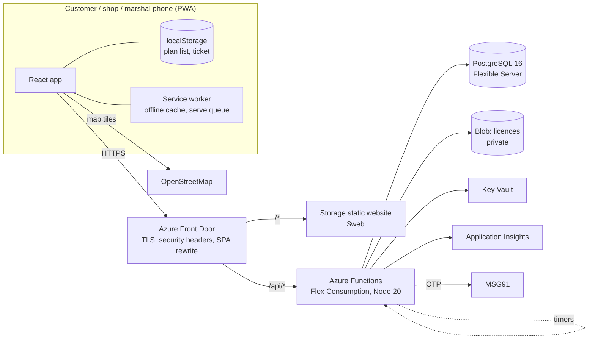
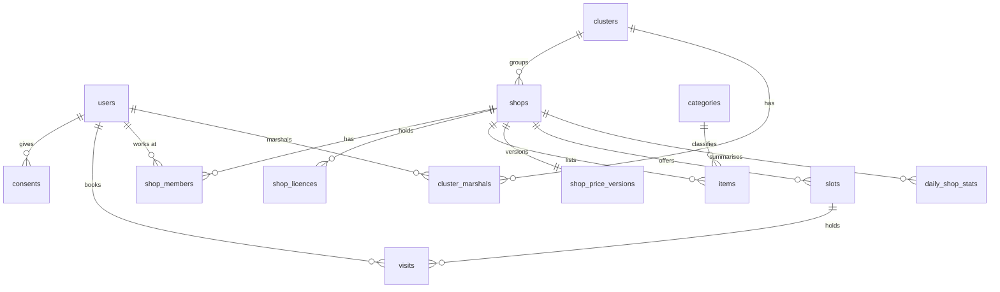

# Festive Diwali — Technical Guide

**Audience:** engineers, ops and the pilot team · **Status:** pilot build (Oct 2026) · **Spec:** [SPEC.md](SPEC.md) · **Deploy:** [DEPLOY.md](DEPLOY.md)

Contents

1. [What the system does (and must never do)](#1-what-the-system-does-and-must-never-do)
2. [Architecture](#2-architecture)
3. [Repository and code map](#3-repository-and-code-map)
4. [Data model](#4-data-model)
5. [API reference](#5-api-reference)
6. [Key flows](#6-key-flows)
7. [Security and privacy](#7-security-and-privacy)
8. [Configuration](#8-configuration)
9. [Local development](#9-local-development)
10. [Testing and quality gates](#10-testing-and-quality-gates)
11. [Deployment and environments](#11-deployment-and-environments)
12. [Operations runbook](#12-operations-runbook)
13. [Known gaps and deviations](#13-known-gaps-and-deviations)
14. [Pilot plan — what to consider](#14-pilot-plan--what-to-consider)
15. [Next phase — scaling for massive crowds](#15-next-phase--scaling-for-massive-crowds)

---

## 1. What the system does (and must never do)

Festive Diwali is a **shop finder, price list and drive-through queue** for licensed cracker shops.

1. A customer browses a licensed shop's green-cracker price list and builds a **plan list on their own phone**.
2. They book a **30-minute pickup slot** and get a **QR ticket** (visit code + plan list).
3. At the ground a **marshal** scans the ticket and sends the car to a **holding bay** away from the stalls.
4. At the counter the shop **scans the list QR**: the device builds a pick list (by rack) and a bill. The customer **pays the shop**.

The Supreme Court bars online sale of crackers (Arjun Gopal v. UoI, 2018 & 2021). The design keeps the platform out of the sale. These guardrails are enforced in code and tests, and **breaking any of them is a release blocker**:

| #   | Guardrail                                                 | Where it is enforced                                                                                                            |
| --- | --------------------------------------------------------- | ------------------------------------------------------------------------------------------------------------------------------- |
| G1  | Item lists never reach the server                         | Plan list in `localStorage` + QR only; `createVisitSchema` is `.strict()` with no items; guardrail test greps schema/migrations |
| G2  | Shops see a list only when the customer is at the counter | QR decoded on the counter device (`Counter.tsx`); serve endpoint takes the code only                                            |
| G3  | No payments                                               | Test fails on any payment SDK dependency or `upi://` link                                                                       |
| G4  | No money on visits, no commission                         | `visits` has no amount columns (tested); reports are footfall only                                                              |
| G5  | Banned words in UI copy                                   | `pnpm copy-lint` (CI) over i18n catalogues and `.tsx` strings                                                                   |
| G6  | Only verified, in-date licensed shops are visible         | `visible_shops` SQL view used by every public query; licence-expiry job                                                         |
| G7  | Green crackers only; banned categories can't hold items   | DB trigger + API check; `green_ref` required (DB check + zod)                                                                   |
| G8  | Safety notice on every ticket                             | `SafetyNotice` component, snapshot test                                                                                         |
| G9  | Phone number only; consent; purge; delete-me              | `consents`, `DELETE /api/me`, `purge` job                                                                                       |

---

## 2. Architecture



| Layer  | Technology                                                                                       | Notes                                                                 |
| ------ | ------------------------------------------------------------------------------------------------ | --------------------------------------------------------------------- |
| Web    | Vite 6, React 18, React Router 6, TanStack Query 5, Tailwind 4, i18next (en/te), vite-plugin-pwa | One PWA, four role areas; ~1.3 MB build (map and scanner lazy-loaded) |
| QR     | `qrcode` (render), `BarcodeDetector` → `@zxing/browser` fallback (scan)                          | Payload uses QR alphanumeric chars only                               |
| Maps   | Leaflet + react-leaflet + OSM tiles                                                              | Attribution shown; tiles cached by the service worker                 |
| API    | Azure Functions v4 (Node programming model), TypeScript, bundled by esbuild to one file          | 51 HTTP + 5 timer functions; one DB pool per worker                   |
| Data   | PostgreSQL 16, Drizzle ORM + drizzle-kit migrations, `pg`                                        | IST business time zone; integer paise                                 |
| Auth   | Phone OTP (bcrypt) → HS256 JWT in httpOnly `pp_session` cookie                                   | Role read from DB per request; `token_version` revocation             |
| Shared | `packages/shared`: zod schemas, QR codec, time/slot maths, roles, copy rules                     | Used by both web and API                                              |
| Infra  | Bicep, GitHub Actions with Azure OIDC                                                            | Front Door, Storage, Functions, Postgres, Key Vault, App Insights     |

**Why this shape:** same-origin `/api` via Front Door means cookie auth with no CORS; the static site is cheap and cache-friendly; Functions scale to zero between festivals; one Postgres keeps the booking transaction simple and atomic.

---

## 3. Repository and code map

```
apps/
  api/                         Azure Functions app
    src/index.ts               single entry; imports every function module
    src/functions/             HTTP + timer registrations (one area per file)
      public.ts                areas, shops, shop detail, price list, slots
      auth.ts  me.ts  demo.ts  OTP sign-in, profile/delete, demo sign-in
      visits.ts                book / current / cancel
      gate.ts                  check-in + bay assignment, today
      shop.ts                  vendor: context, items, hours/slots, queue, serve, no-show, stats, licence
      console.ts adminMembers.ts  admin: grounds, shops, categories, licences, users, metrics, roles
      timers.ts                schedules for lib/jobs.ts
    src/lib/                   auth, access (shop/cluster scoping), slots, visits, catalogue,
                               reports, jobs, rateLimit, otp, storage, http (route wrapper), env
    src/db/                    schema.ts, client.ts, migrations/ (0000–0003)
    scripts/                   migrate, seed (+ demo licence image), grant-admin, purge-dry-run
    test/                      integration tests (real Postgres)
  web/
    src/routes/customer/       Home, ShopPage, PlanPage, BookPage, TicketPage
    src/routes/shop/           ShopLayout, ShopToday, Counter, Prices, Slots, Licence, Report
    src/routes/gate/Gate.tsx
    src/routes/admin/          Overview, Licences, Shops, Clusters, Categories, Members, Blocked
    src/components/            design system (ui.tsx), Layout, QrCode, QrScanner, ShopMap, DemoSwitcher…
    src/lib/                   api client, queries (all data hooks), planList, ticketStore, format
    src/i18n/en.json te.json   every UI string
packages/shared/src/           qr.ts, time.ts, money.ts, roles.ts, phone.ts, copy.ts, schemas.ts, domain.ts
infra/                         main.bicep, params.dev.json, params.prod.json, db-roles.sql
scripts/                       embedded-db.mjs, copy-lint.mjs, wait-port.mjs
docs/                          SPEC.md, DEPLOY.md, TECH_GUIDE.md
```

Conventions: every handler goes through `route()` (CSRF check, error mapping), parses bodies with strict zod schemas, checks role **and** membership (`requireShop`, `requireCluster`), and writes `audit_log` on mutations. All UI copy is in the i18n files.

---

## 4. Data model



| Table                               | Purpose / key rules                                                                                                                                |
| ----------------------------------- | -------------------------------------------------------------------------------------------------------------------------------------------------- |
| `users`                             | phone (E.164), role, `no_show_strikes`, `blocked_until`, `token_version`, `deleted_at`                                                             |
| `consents`                          | purpose + version per user; withdrawn on delete/purge                                                                                              |
| `otp_requests`                      | bcrypt hash, 5-min expiry, attempt counter                                                                                                         |
| `rate_limits`                       | fixed-window counters (phone and IP)                                                                                                               |
| `clusters`                          | grounds: location, `bay_count`, gate notes                                                                                                         |
| `shops`                             | `short_code` (`^[A-Z0-9]{3,6}$`), hours, slot length, default capacity, `is_live`                                                                  |
| `shop_licences`                     | licence no/type/validity, private photo path, `pending/verified/rejected/expired`                                                                  |
| `shop_members` / `cluster_marshals` | vendor ↔ shop, marshal ↔ ground                                                                                                                    |
| `categories`                        | `is_banned` + reason (series/lari, barium seeded as banned)                                                                                        |
| `items`                             | `item_no` (per shop, used in QR), `price_paise > 0`, `green_cert`, `green_ref` required, `price_version` of last price change                      |
| `shop_price_versions`               | bumped on every item change; counters flag lists older than an item's price change                                                                 |
| `slots`                             | `(shop_id, starts_at)` unique, `booked <= capacity`                                                                                                |
| `visits`                            | 6-char Crockford code, status `booked/arrived/served/no_show/cancelled`, bay; **unique active visit per user** (partial index); no items, no money |
| `daily_shop_stats`                  | footfall snapshot that survives the purge                                                                                                          |
| `audit_log`                         | who did what                                                                                                                                       |
| view `visible_shops`                | live AND verified licence valid today (IST) — the only public source of shops                                                                      |

---

## 5. API reference

All under `/api`. JSON in/out. Errors: `{ "error": { "code", "message" } }`. Mutations need header `X-PP: 1`. Auth = `pp_session` cookie.

| Area     | Method & path                                                                                                                                                                                                                                                                                                                                                                                         | Who                                                                                               |
| -------- | ----------------------------------------------------------------------------------------------------------------------------------------------------------------------------------------------------------------------------------------------------------------------------------------------------------------------------------------------------------------------------------------------------- | ------------------------------------------------------------------------------------------------- |
| Health   | `GET /health` (200/503 with DB ping)                                                                                                                                                                                                                                                                                                                                                                  | public                                                                                            |
| Public   | `GET /areas` · `GET /shops?area=&lat=&lng=` · `GET /shops/{code}` · `GET /shops/{code}/items` (ETag) · `GET /shops/{code}/slots?date=`                                                                                                                                                                                                                                                                | public                                                                                            |
| Auth     | `POST /auth/otp/request` · `POST /auth/otp/verify` · `POST /auth/logout` · `GET /me` · `DELETE /me`                                                                                                                                                                                                                                                                                                   | public / signed in                                                                                |
| Demo     | `GET /auth/demo` · `POST /auth/demo/login` (only when `DEMO_MODE` and not prod)                                                                                                                                                                                                                                                                                                                       | public                                                                                            |
| Customer | `POST /visits` · `GET /visits/current` · `POST /visits/{code}/cancel`                                                                                                                                                                                                                                                                                                                                 | any signed-in user                                                                                |
| Gate     | `POST /gate/checkin` `{code, bayNo?}` · `GET /gate/today`                                                                                                                                                                                                                                                                                                                                             | marshal (own ground), admin (`?cluster=`)                                                         |
| Shop     | `GET /shop/context` · `GET /shop/items` · `POST /shop/items/new` · `PATCH /shop/items/{id}` · `PATCH /shop/items/{id}/sold-out` · `PUT /shop/settings` · `GET /shop/slots` · `PUT /shop/slots/day` · `PATCH /shop/slots/{id}` · `GET /shop/visits/today` · `POST /shop/visits/{code}/serve` · `POST /shop/visits/{code}/no-show` · `GET /shop/stats` · `GET /shop/licence` · `POST /shop/licence/new` | owner (all) · staff (context, items read, sold-out, queue, serve, no-show) · admin (`?shop=CODE`) |
| Admin    | `GET/POST /console/members` · `GET /console/clusters` · `POST /console/clusters/new` · `PATCH /console/clusters/{id}` · same for `shops` and `categories` · `GET /console/licences?status=` · `GET /console/licences/{id}/image` · `POST /console/licences/{id}/verify                                                                                                                                | reject`·`GET /console/users/blocked`·`POST /console/users/{id}/unblock`·`GET /console/metrics`    | admin |

Timers (UTC schedules): `noShowSweeper` every 5 min · `licenceExpiry` hourly · `dailyStats` 23:55 IST · `slotGenerator` 00:10 IST · `purge` 03:00 IST.

Common error codes: `unauthorized`, `forbidden`, `owner_only`, `csrf`, `invalid_body`, `rate_limited`, `otp_wrong|otp_expired|otp_locked`, `slot_full`, `slot_too_soon`, `active_visit_exists`, `blocked`, `category_banned`, `wrong_cluster`, `too_early`, `too_late`, `already_checked_in`, `bays_full`, `wrong_shop`.

---

## 6. Key flows

### Booking (atomic, overbooking-proof)

```sql
UPDATE slots SET booked = booked + 1
 WHERE id = $slot AND shop_id = $shop AND booked < capacity AND starts_at > now() + 30 min
RETURNING id;               -- 0 rows → slot_full / slot_too_soon
INSERT INTO visits (...);   -- same transaction; partial unique index = one active visit per user
```

Tested: 50 parallel requests on a capacity-10 slot → exactly 10 succeed.

### QR payload (`packages/shared/src/qr.ts`)

```
PP1.<VISITCODE|->.<SHOPCODE>.<PRICEVER base36>.<itemNo*qty base36 joined by ->
PP1.44MDCF.SLC01.1.1*2-C*1-E*1   → ticket 44MDCF, SLC01, price v1, #1×2, #12×1, #14×1
```

Max 40 lines, qty 1–99, alphanumeric QR mode. Property-tested round trip.

### Counter

Scan → `decodePlan` → shop code must match → join with the cached own price list → pick list grouped by `rack_code` → bill using **today's** prices; lines flagged when `item.price_version > PRICEVER` or sold out/unknown → print (58 mm CSS) → `POST /shop/visits/{code}/serve` (code only). Offline: the price list is cached; serve calls queue in the service worker (`serve-queue`) and replay later; serving twice is harmless.

### Gate

Scan → visit must belong to a shop in the marshal's ground, status `booked`, time window −30 min … slot end +15 min (skipped in demo mode) → next free bay (advisory lock per ground) → `arrived`.

### No-shows

`booked` and not checked in by slot end + 15 min → `no_show`, place freed, strike +1; 3 strikes → blocked until season end (admin can unblock).

---

## 7. Security and privacy

- **Sessions:** httpOnly, Secure, SameSite=Lax cookie; 30 days customers / 12 h staff; JWT `ver` must match `users.token_version` (logout, delete and role change revoke all sessions).
- **CSRF:** `X-PP: 1` on all mutations + SameSite cookie + same origin.
- **OTP:** bcrypt, 5-minute expiry, 5 attempts, 3 requests/phone/10 min, 10/IP/hour.
- **Authorisation:** role from DB on every request; row-level membership checks for shop/gate; admin-only licence photos are streamed through the API (never public URLs).
- **Input:** strict zod schemas (unknown keys rejected); image uploads checked by magic bytes; 3 MB cap.
- **Transport and edge:** HTTPS-only, HSTS, CSP, `nosniff`, Referrer-Policy, Permissions-Policy (camera/geolocation self) set at Front Door. The Function App accepts traffic **only** from this Front Door profile.
- **Secrets:** Key Vault references; Functions use managed identity for Storage and Key Vault; storage shared keys disabled.
- **Database:** TLS required; the app runs as `festive_app` (no DDL); migrations use the admin login in CI only.
- **Privacy (DPDP 2023):** phone number only, consent recorded with version, delete-me, daily OTP clean-up, full purge 90 days after `SEASON_END` (visits deleted, customers anonymised, stats kept).
- **Demo mode:** forced off in prod by Bicep and ignored by the API when `APP_ENV=prod`.

---

## 8. Configuration

| Variable                              | Used by     | Meaning                                                               |
| ------------------------------------- | ----------- | --------------------------------------------------------------------- |
| `DATABASE_URL`                        | API         | Postgres URL (Key Vault ref in Azure)                                 |
| `DATABASE_SSL`                        | API         | `false` only for local dev                                            |
| `JWT_SECRET`                          | API         | ≥ 32 chars outside dev                                                |
| `APP_ENV`                             | API         | `dev` / `prod` (prod disables demo + dev OTP)                         |
| `DEMO_MODE`                           | API         | one-tap demo sign-in, relaxed gate window                             |
| `OTP_DEV_MODE`                        | API         | OTP always `123456`, logged not sent                                  |
| `MSG91_AUTH_KEY`, `MSG91_TEMPLATE_ID` | API         | SMS OTP (DLT template)                                                |
| `SEASON_END`                          | API         | IST date; block end + purge anchor                                    |
| `STORAGE_ACCOUNT_NAME`                | API         | licence photos in Blob (managed identity); unset → local `UPLOAD_DIR` |
| `UPLOAD_DIR`                          | API (local) | local licence photo folder                                            |
| `COOKIE_SECURE`                       | API (local) | `false` to test over plain HTTP on a LAN phone                        |
| `AzureWebJobsStorage(__accountName)`  | Functions   | timer leases                                                          |
| `TEST_DATABASE_URL`                   | tests       | use an existing Postgres instead of embedded                          |
| `VITE_API_BASE`                       | web build   | defaults to `/api`                                                    |

---

## 9. Local development

```bash
pnpm install
cp apps/api/local.settings.example.json apps/api/local.settings.json
pnpm db:embedded            # Postgres 16 (UTF-8) without Docker — keep running; or docker compose up -d
pnpm db:migrate && pnpm db:seed
pnpm dev                    # web :5173 (proxies /api) · Functions :7071 · Azurite :10000-10002
```

Use **Choose a role** in the header (demo mode). Seeded phones: admin `+919000000001`, owner `…011`, staff `…012`, marshal `…051`, customer `…099`. To test on a phone on the same Wi-Fi: `pnpm --filter web dev --host`, open `http://<pc-ip>:5173` (camera needs HTTPS except on localhost — use photo or typed code, or a tunnel).

Schema change: edit `apps/api/src/db/schema.ts` → `pnpm db:generate` → review SQL → `pnpm db:migrate`.

---

## 10. Testing and quality gates

| Command         | What                                                                                                                               |
| --------------- | ---------------------------------------------------------------------------------------------------------------------------------- |
| `pnpm check`    | typecheck, ESLint, copy-lint (G5), unit tests (shared, API guardrails, web components)                                             |
| `pnpm test:int` | API integration tests on real Postgres: auth, RBAC, booking concurrency, G1/G6/G7, gate, counter, no-show time travel, purge, demo |
| `pnpm build`    | web PWA + bundled API                                                                                                              |
| CI              | all of the above + `az bicep build` on every PR                                                                                    |

Current counts: 89 unit, 56 integration tests. A live audit script exercised all endpoints as every role (72/72).

---

## 11. Deployment and environments

See [DEPLOY.md](DEPLOY.md). Summary: push to `main` → **dev** (demo on, seeded), tag `v*` → **prod** (approval, demo off). The workflow deploys Bicep, opens a temporary Postgres firewall hole for the runner, runs migrations and the DB role script, zip-deploys the API, uploads the site with correct cache headers, purges Front Door and smoke-tests `/api/health`.

Rollback: re-run the deploy for the previous tag (static site and API are replaced atomically per run). Migrations are additive; do not write destructive migrations during the season.

---

## 12. Operations runbook

| Symptom                    | Check                                                         | Action                                                                                                 |
| -------------------------- | ------------------------------------------------------------- | ------------------------------------------------------------------------------------------------------ |
| Health alert / site down   | App Insights failures, `/api/health`                          | DB down → Postgres blade / restart; API down → redeploy last tag                                       |
| OTP not arriving           | MSG91 dashboard, DLT status, App Insights `MSG91 send failed` | Fix template/credit; staff can still use existing sessions (12 h)                                      |
| Gate scanner fails         | Camera permission, light                                      | Use **Scan from photo** or type the 6-letter code; print **Today's codes** from the shop app           |
| No internet at a ground    | —                                                             | Counter still decodes and bills (cached prices); serve taps sync later                                 |
| Shop overloaded            | Shop → Today, Admin → metrics (arrive→serve)                  | Owner lowers capacity for later slots (booked places kept)                                             |
| Licence questioned         | —                                                             | Admin → Shops → switch **Live** off (hidden at once)                                                   |
| Customer blocked wrongly   | Admin → Blocked numbers                                       | Unblock                                                                                                |
| Need data deleted          | —                                                             | Customer uses My account → Delete; or purge dry run: `pnpm --filter api purge:dry-run --at=YYYY-MM-DD` |
| Police / fire officer asks | —                                                             | Show `/about` (no sales, no payments, licensed shops, green only)                                      |

---

## 13. Known gaps and deviations

**Not built yet:** Playwright E2E tests; Phase 8 hardening (Lighthouse, k6 load test, restore drill, READINESS.md); bulk sold-out; manual bay choice on the gate screen (API supports it); SMS fallback (WhatsApp / admin one-time code); web-vitals and custom App Insights telemetry; item and shop photos; Hindi.

**Never run outside this PC:** Azure deployment (Bicep is CI-compiled only), MSG91 SMS, camera scanning on real phones, offline serve queue, 58 mm printing.

**Deviations from SPEC:** admin API at `/api/console/*` (Functions reserves `/api/admin`); licence photos uploaded through the API instead of SAS URLs; embedded Postgres instead of Testcontainers locally; no PgBouncer on Burstable (pool × max instances capped); no public `shop-media` container.

---

## 14. Pilot plan — what to consider

**Scope:** 5–10 licensed shops in 1–2 grounds, ≤ 500 visits/day, live **29 Oct**, Diwali **8 Nov 2026**.

### 14.1 Go / no-go gates (all must be green)

| Gate                                                                                                     | Owner     | By     |
| -------------------------------------------------------------------------------------------------------- | --------- | ------ |
| Written legal opinion on plan list + slot model                                                          | Owner     | 17 Oct |
| MSG91 DLT sender + OTP template approved; test OTP received on Jio, Airtel, Vi                           | Owner/Eng | 22 Oct |
| First Azure deploy of dev and prod; smoke test green; demo off in prod                                   | Eng       | 24 Oct |
| Shops onboarded: licence photo uploaded and verified, price list entered, staff phones assigned          | Ops       | 26 Oct |
| Holding bays agreed with fire officer and police; bay numbers painted/signed; ground `bay_count` matches | Ops       | 26 Oct |
| Device test (below) passed at night on the ground                                                        | Eng/Ops   | 27 Oct |
| Dry run with 20 friendly customers end to end                                                            | All       | 28 Oct |

### 14.2 Devices, power and network at the ground

- **Counter:** one mid-range Android phone (Chrome) per counter, installed as an app. Charge **away from the stall**: Schedule V LE-6 forbids electrical wires within 15 m of displayed fireworks, so use power banks charged outside the safety zone, and no extension cords.
- **Printing:** browsers print to Bluetooth 58 mm printers only through an Android print service (e.g. a RawBT-type app). Test the exact printer model; keep paper bills optional, since the on-screen bill is enough.
- **Gate:** one phone per lane with a torch; also test **Scan from photo** and typed codes.
- **Camera test matrix:** 3 Android phones (cheap, mid, flagship) + 2 iPhones; scan tickets at 30 % screen brightness, at night, under sodium/LED light, through a car window.
- **Network:** test 4G at the exact spot during evening peak; the counter works offline but sign-in and booking need data. Consider a 4G router with two SIMs per ground.

### 14.3 Capacity settings (start conservative)

Set each shop's capacity from counter speed, not from demand:

```
capacity per 30-min slot ≈ counters × (30 ÷ minutes per customer) × 0.8
e.g. 2 counters × (30 ÷ 3) × 0.8 = 16
```

Start at **10 per slot**, read **Admin → Overview → arrive→served median** after day 1, and adjust. Keep the ground's holding bays ≥ the peak number of cars expected within any 30 minutes across all its shops.

### 14.4 People and process

- One **marshal per gate lane** at peak, one **runner** if bags are walked to bays, a **floor lead** per ground with the admin role on their phone.
- 20-minute training per shop: Today list, Scan list, sold-out toggle, Mark served, no-show.
- Print and keep: today's codes per shop (shop app → Print), the `/about` page, a support phone number.
- Paper fallback: if the platform is down, shops serve walk-ins as usual and the gate lets ticket holders in by code list.

### 14.5 What to measure (pilot success)

| Metric                               | Source                               | Target          |
| ------------------------------------ | ------------------------------------ | --------------- |
| Slots booked / day, show-up rate     | Admin → Overview                     | show-up ≥ 80 %  |
| No-show rate                         | Admin → Overview                     | ≤ 15 %          |
| Arrive → served (median)             | Admin → Overview                     | ≤ 10 min        |
| Counter time per customer            | stopwatch sample + served timestamps | ~3 min          |
| Gate scan success first try          | marshal tally                        | ≥ 95 %          |
| API 5xx, p95 latency                 | App Insights                         | < 1 %, < 500 ms |
| Shop renewal intent, customer rating | short survey                         | ≥ 4/5           |

### 14.6 Pilot technical checklist

- [ ] `DEMO_MODE`/`OTP_DEV_MODE` off in prod (check `/api/auth/demo` returns `enabled:false`).
- [ ] First admin granted with `admin:grant`; demo accounts absent in prod.
- [ ] Alerts reach the on-call phone (send a test).
- [ ] Postgres point-in-time restore tried once on a copy.
- [ ] Telugu reviewed by a native speaker.
- [ ] Load test (k6): 50 rps on price lists, 10 rps bookings, p95 < 500 ms.
- [ ] On-call rota for 29 Oct – 9 Nov evenings (5 pm – 11 pm).
- [ ] Code freeze except fixes until 9 Nov.

---

## 15. Next phase — scaling for massive crowds

The pilot is sized for ~10 shops and hundreds of visits a day. A city-wide rollout (hundreds of shops, dozens of grounds, **100k+ visitors on the peak day**, sudden spikes when slots open) needs both **software** and **crowd-flow** changes. The real bottleneck is physical (counters, bays, roads), so the software must **shape demand** to what the ground can serve.

### 15.1 Planning numbers (assumptions to validate)

| Item                             | Pilot   | City-wide target   |
| -------------------------------- | ------- | ------------------ |
| Shops / grounds                  | 10 / 2  | 300–500 / 40–60    |
| Visits on peak day               | ≤ 2,400 | 100k–150k          |
| Price-list reads at peak         | ~5 rps  | 2,000–5,000 rps    |
| Booking attempts at slot release | ~1 rps  | 200–500 rps bursts |
| OTP sends / hour at peak         | <100    | 20k–40k            |
| Shop + gate screens polling      | ~20     | 2,000–3,000        |

### 15.2 Software roadmap

**Phase A — absorb read traffic (cheap, do first)**

1. **Publish price lists as static JSON** to Blob/Front Door on every price change (`/data/shops/{code}/items.v{n}.json`, immutable). The app reads from the edge; the database sees almost no catalogue reads.
2. Cache `/shops` and `/areas` at Front Door for 30–60 s (`s-maxage`), and move "next free slot" to a lightweight per-ground counter.
3. Add **PostGIS** and a geo index when shops exceed ~1,000; return nearest N shops.

**Phase B — protect the write path (bookings and OTP)**

4. **Virtual waiting room** at Front Door/Front Door Premium WAF for slot-release moments: admit users at a controlled rate; show a position and wait time.
5. **Staggered slot release:** open slots for day D at several fixed times per area, not all at once. Publish times in the app.
6. **Edge rate limiting and bot protection** (Front Door Premium WAF): per-IP and per-phone limits on `/auth/*` and `/visits`; CAPTCHA only on abuse signals. Move `rate_limits` from Postgres to **Azure Cache for Redis**.
7. **OTP cost and resilience:** short-lived device trust, WhatsApp OTP fallback, OTP only when booking (already true), alert on OTP spend per hour.
8. **Database:** move to General Purpose (4–8 vCores) with **built-in PgBouncer**, a **read replica** for reports, and monthly partitioning of `visits`. The booking `UPDATE … booked < capacity` stays correct and fast because contention is per slot row, spread across thousands of slots.
9. **Compute:** raise the Flex Consumption instance cap with the larger pool, or move steady APIs to Azure Container Apps; split read APIs from write APIs.

**Phase C — real-time operations at the grounds**

10. Replace 10-second polling with **Azure Web PubSub / SignalR** for shop and gate screens (thousands of screens without polling load).
11. **Signed tickets (PP2):** add an HMAC signature to the QR so the gate can validate tickets **offline** against a day's key, then sync check-ins; essential when mobile networks saturate on the peak night.
12. **Live ground status** ("quiet / busy / full") per ground and per shop on the home page, fed by arrivals vs serves, so customers spread out.

### 15.3 Crowd-flow features (the real overflow controls)

| Feature                            | What it does                                                                                                            |
| ---------------------------------- | ----------------------------------------------------------------------------------------------------------------------- |
| **Throughput-based capacity**      | Capacity per slot = measured counter rate × counters × 0.8, updated daily per shop automatically                        |
| **Ground-level cap**               | Sum of all shops' slot capacity at a ground ≤ bays × turnover; prevents bay overflow even if each shop is within limits |
| **Arrival windows**                | Ticket shows "arrive 10 min before"; the gate refuses early cars (already ±30/15 min)                                   |
| **Waitlist and released places**   | Cancelled/no-show places offered to a waitlist by SMS/push, with a 10-minute hold                                       |
| **Controlled overbooking**         | Add a small, measured buffer (e.g. +5 %) only where no-show rates are proven high                                       |
| **Load-balancing nudges**          | When a shop is full, suggest the nearest licensed shop with free slots (never sell, just suggest)                       |
| **Pre-registration for peak days** | Open 7 Nov / 8 Nov slots a few days ahead in waves, by area                                                             |
| **Bay sensors / marshal counts**   | Marshal "bay freed" taps (or served events) drive live occupancy and auto-pause check-ins at full                       |
| **Pickup-only express lanes**      | Separate lanes for ticket holders vs walk-ins at large grounds                                                          |
| **Traffic integration**            | Share expected arrivals per hour with traffic police a day ahead (aggregate, no personal data)                          |

### 15.4 Reliability for the peak night

- **SLOs:** 99.9 % availability 5–11 pm, p95 < 300 ms for reads, < 800 ms for bookings.
- **Load tests** (k6) at 3× expected peak, including slot-release bursts and OTP storms; run weekly in the run-up.
- **Multi-region:** static site served from two storage origins (Central + South India) behind Front Door; Postgres geo-redundant backup with a tested restore runbook; API in a second region behind Front Door priority routing.
- **Feature flags** to switch off non-essential features (maps, reports) under load.
- **Kill switch:** an admin toggle that stops new bookings city-wide but keeps tickets, gate and counter working.
- **War room:** dashboards for bookings/min, check-ins/min per ground, serve rate, 5xx, OTP failures, DB CPU; on-call with clear escalation.

### 15.5 Suggested sequence

| When                  | Do                                                                                                            |
| --------------------- | ------------------------------------------------------------------------------------------------------------- |
| After pilot (Nov)     | Review metrics, fix pain points, Playwright E2E, k6 baseline                                                  |
| Q1 2027               | Phase A (static price lists, edge caching), signed tickets, admin one-time code + WhatsApp OTP                |
| Before next season    | Phase B (waiting room, WAF, Redis, GP Postgres + PgBouncer), waitlist, throughput-based capacity, ground caps |
| 6 weeks before Diwali | Phase C (real-time screens, live ground status), multi-region, 3× load tests, war-room drill                  |
| Year-round            | Reuse the engine for Ganesh idols, Sankranti kites, festive sweets (same plan-list + slot model)              |

### 15.6 Rough monthly cost (verify in the Azure pricing calculator)

| Stage     | Main items                                                                                                         | Order of magnitude                                       |
| --------- | ------------------------------------------------------------------------------------------------------------------ | -------------------------------------------------------- |
| Pilot     | Front Door Std, Postgres B1ms, Functions, Storage, App Insights                                                    | US$60–100 + SMS                                          |
| City-wide | Front Door Premium (WAF), Postgres GP 4–8 vCores + replica, Redis, Web PubSub, Functions/Container Apps, more logs | US$800–2,000 during season + SMS (largest variable cost) |

Scale everything down after the season: the architecture is pay-per-use apart from Postgres, which can be stopped or downsized between festivals.
